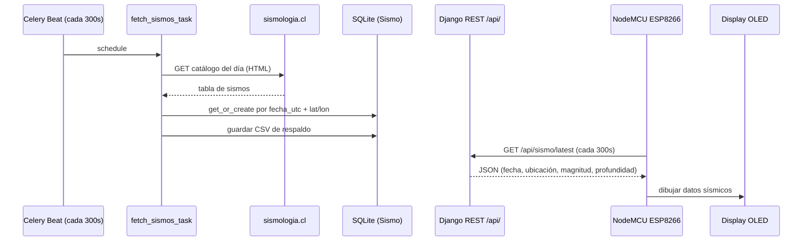

# oled-quake-viewer

Captura datos sísmicos de Chile (sismología.cl), los expone vía un backend Django REST y los muestra en un NodeMCU ESP8266 con pantalla OLED. Usa Celery para la obtención periódica y el scheduling.

[](LICENSE)
[](https://python.org)
[](https://github.com/bi0punk/oled-quake-viewer/actions/workflows/ci.yml)

## Contenido

- [Características](#características)
- [Arquitectura](#arquitectura)
- [Stack](#stack)
- [Estructura del repositorio](#estructura-del-repositorio)
- [Instalación](#instalación)
- [Uso](#uso)
- [Configuración](#configuración)
- [Tests / CI](#tests--ci)
- [Datos](#datos)
- [Roadmap](#roadmap)
- [Licencia](#licencia)

## Características

- Obtención periódica de datos sísmicos desde el catálogo de sismología.cl (scraping de la tabla HTML del catálogo diario).
- Visualización en display OLED (SSD1306 128x64) vía NodeMCU ESP8266.
- Backend Django REST Framework con modelos `Sismo` y endpoints de sismos.
- Programación de tareas con Celery Beat + Redis (obtención cada 5 minutos).
- Almacenamiento local en SQLite con respaldo CSV (`sismos_respaldo.csv`).
- Deduplicación de registros (evita insertar sismos ya existentes).

## Arquitectura



El endpoint consumido por el ESP8266 es `/api/sismo/latest/` (`latest_earthquake`), que devuelve los campos `fecha_local`, `fecha_utc`, `ubicacion`, `latitud`, `longitud`, `profundidad`, `magnitud`.

## Stack

- Python 3.11+, Django 4.2, Django REST Framework.
- Celery 5.3 + Redis (broker/backend) + django-celery-beat.
- SQLite, pandas, requests, BeautifulSoup.
- NodeMCU ESP8266 + display OLED (Adafruit SSD1306).

## Estructura del repositorio

```
oled-quake-viewer/
├── core/
│   ├── __init__.py
│   ├── asgi.py
│   ├── celery.py             # app Celery
│   ├── settings.py           # settings + CELERY_BEAT_SCHEDULE (300s)
│   ├── urls.py               # monta /api/
│   └── wsgi.py
├── quakeApi/
│   ├── __init__.py
│   ├── admin.py
│   ├── apps.py
│   ├── models.py             # Sismo
│   ├── quake.py              # scraping de sismologia.cl + CSV respaldo
│   ├── serializers.py
│   ├── tasks.py              # fetch_sismos_task (Celery)
│   ├── templates/quakeApi/index.html
│   ├── tests.py
│   ├── urls.py               # sismos/, sismo/latest/, api
│   ├── views.py              # ListaSismos, DetalleSismo, api, latest_earthquake
│   └── migrations/
├── oled_screen_data/
│   └── oled_screen_data.ino  # firmware NodeMCU ESP8266 + OLED
├── tests/test_smoke.py
├── manage.py
├── requirements.txt
├── pyproject.toml
├── .env.example
└── LICENSE
```

## Instalación

Requisitos: Python 3.11+, servidor Redis (para Celery) y, opcionalmente, un NodeMCU ESP8266 con display OLED (solo visualización física).

```bash
git clone https://github.com/bi0punk/oled-quake-viewer.git
cd oled-quake-viewer
python -m venv .venv && source .venv/bin/activate
pip install -r requirements.txt
python manage.py migrate
```

## Uso

Iniciar servidor Django y workers Celery:

```bash
# Servidor de desarrollo
python manage.py runserver

# Worker Celery (terminal 2)
celery -A quakeApi worker -l info

# Beat scheduler (terminal 3)
celery -A quakeApi beat -l info
```

Endpoints REST (bajo `/api/`):

| Método | Ruta               | Descripción                              |
|--------|--------------------|------------------------------------------|
| GET    | `/api/`            | Últimos 7 sismos (JSON)                  |
| GET    | `/api/sismos/`     | Listado / alta de sismos (DRF)           |
| GET    | `/api/sismos/<pk>/`| Detalle / edición / borrado de un sismo  |
| GET    | `/api/sismo/latest/` | Último sismo registrado (JSON)         |

Firmware ESP8266: en `oled_screen_data.ino` completa las constantes `ssid`, `password` y `serverUrl` (apunta a `http://IP_DEL_SERVIDOR:8000/api/sismo/latest/`) y súbelo al NodeMCU. El dispositivo consulta cada 5 minutos y muestra fecha, ubicación, latitud/longitud, magnitud y profundidad en el OLED.

## Configuración

Variables de entorno (ver `.env.example`):

| Variable                | Default                          | Descripción                        |
|-------------------------|----------------------------------|------------------------------------|
| `SECRET_KEY`            | `change-me-to-a-random-secret-key` | Clave secreta de Django          |
| `DEBUG`                 | `True`                           | Modo debug                         |
| `DATABASE_URL`          | `sqlite:///db.sqlite3`           | URL de la base de datos (SQLite)   |
| `CELERY_BROKER_URL`     | `redis://localhost:6379/0`       | Broker de Celery                   |
| `CELERY_RESULT_BACKEND` | `redis://localhost:6379/0`       | Backend de resultados de Celery    |

> Nota: `core/settings.py` lee del entorno `DJANGO_SECRET_KEY`, `DJANGO_DEBUG` y `DJANGO_ALLOWED_HOSTS`, y fija `CELERY_BROKER_URL`/`CELERY_RESULT_BACKEND` en `redis://localhost:6379/0`. El schedule de Celery Beat ejecuta `fetch_sismos_task` cada 300 segundos.

## Tests / CI

```bash
pip install pytest ruff
pytest -q
ruff check .
```

CI — GitHub Actions (`.github/workflows/ci.yml`) sobre Python 3.11 con `uv`, en cada push y PR:

- `ruff check .`.
- `pytest -q`.

## Datos

Los datos sísmicos se almacenan en SQLite (`db.sqlite3`) con respaldo periódico en `sismos_respaldo.csv`. El modelo `Sismo` incluye campos para fecha local/UTC, ubicación, latitud, longitud, profundidad y magnitud.

## Roadmap

- [x] Obtención periódica de sismos con Celery + scraping de sismologia.cl.
- [x] API REST de sismos y visualización en OLED ESP8266.
- [ ] Soporte para múltiples displays OLED.
- [ ] Dashboard web con gráficos históricos.
- [ ] Alertas en tiempo real via WebSocket.
- [ ] Dockerización completa del stack.

## Licencia

MIT — ver [LICENSE](LICENSE).